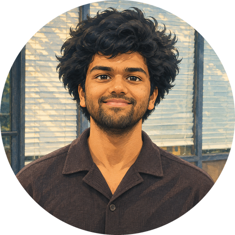
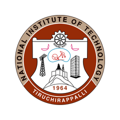
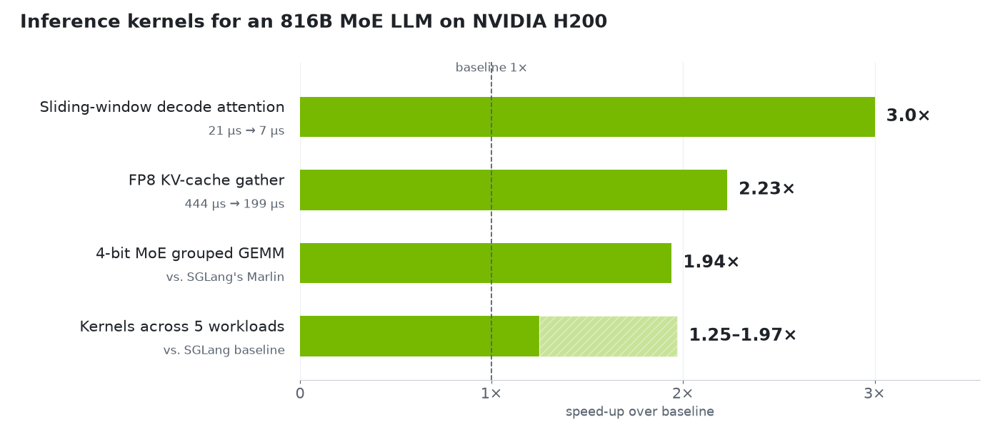

<!-- ============================ HEADER ============================ -->

  

  
  
  
  
  

  
  
  
  
  

   
  ML systems · LLM inference · agents · applied research

## 👋 About me

- 🎓 MS ECE (Machine Learning & Data Science) at **UC San Diego**, finishing Dec 2026
- 🧠 Researching autonomous AI agents with **[Prof. Pengtao Xie](https://pengtaoxie.github.io/)**
- ⚡ Writing GPU kernels and benchmarking LLM inference across hardware
- 🩺 Before that: medical imaging and surgical AI at **IIT Madras**, **A\*STAR Singapore** and **IISc Bengaluru**

 

## 🧭 Experience

 
**Student Researcher, Autonomous AI Systems.** Cross-task memory and a cost-aware experiment controller for data-engineering agents. Graph retrieval cut **time-to-target 16.9%** and **API cost 14.8%**.

 
**Mobile Computer Vision Intern.** Shipped a YOLO ball detector to iPhone at **42 ms/frame** (FP16 Core ML), lifted recall **0.65 → 0.92**, and automated stereo recalibration (rotation error **7.95° → 0.54°**).

 
**Data Science / ML Intern.** Patient-retention analytics for remote hypertension and diabetes care, and cuffless blood pressure from PPG with AutoML agents calibrating from **~10 samples**.

 
**Research Assistant.** Compressed a DINOv2 surgical classifier **344 MB → 22 MB** (3.5× faster on CPU, 98.2% of teacher accuracy), SAM 2 for surgical video at **89.4% mIoU**, and 2D-to-3D coronary reconstruction deployed with Meril Life Sciences.

 
**Research Intern.** Spatial-attention segmentation of defects in X-ray CT for metal 3D printing, published at ICT 2026.

Earlier: research at NIT Trichy's MICAIH and Motorola labs (3 papers) and a summer fellowship at IISc Bengaluru.

## 🎓 Education

<table>
<tr>
<td align="center" width="33%" valign="top">
 
<b>UC San Diego</b> 
 
Sep 2025 – Dec 2026  
Systems for LLMs &amp; Agents · Optimization &amp; Acceleration of DL on Hardware · Deep Generative Models · Statistical Learning
</td>
<td align="center" width="33%" valign="top">
 
<b>NIT Tiruchirappalli</b> 

 
Jul 2021 – May 2025 · Minor in CS  
Operating Systems · Data Structures &amp; Algorithms · VLSI Systems · Pattern Recognition President, Office of International Relations
</td>
<td align="center" width="33%" valign="top">
 
<b>IIT Madras</b> 
 
Jul 2024 – May 2025 · final year  
Deep Learning for Imaging · Medical Image Analysis · Computer Networks · Mapping DSP Algorithms to Architectures
</td>
</tr>
</table>

## 🧪 Selected projects

<table>
<tr>
<td width="50%" valign="top">

**⚡ Inference kernels for an 816B MoE LLM** 
Muse Spark Open Kernel Challenge, NVIDIA H200. Hand-written attention, MoE grouped-GEMM and projection kernels, **1.25–1.97× faster than SGLang**. 4-bit MoE weights are dequantized in registers, beating Marlin by **1.94×**.

`CUDA C++` `PTX` `Triton` `Gluon`
</td>
<td width="50%" valign="top">

**[🔁 Attention kernel portability](https://github.com/Srivatsan6923/attention-kernel-portability)** 
16 attention backends on 6 NVIDIA GPUs, 54K+ timings. The fastest backend changes across GPU generations in **42% of prefill** cases, and reusing another GPU's pick costs **1.61× at p95**. [Paper](https://github.com/Srivatsan6923/attention-kernel-portability/blob/main/paper/main.pdf)

`FlashAttention-2/3` `FlashInfer` `SDPA`
</td>
</tr>
<tr>
<td width="50%" valign="top">

**[🎥 SurgLedger-C2F](https://github.com/Srivatsan6923/SurgLedger-C2F)** · 8th place, MICCAI 2026 
Video QA over surgeries that last hours. Qwen3-VL-8B + LoRA with a training-free second look that **doubles temporal localization accuracy**, served offline at 9.4 s per question.

`Qwen3-VL` `LoRA` `vLLM` `DDP`
</td>
<td width="50%" valign="top">

**[🩺 MedGemma-27B clinical failure modes](https://github.com/Srivatsan6923/medgemma-failures)** 
Two pre-registered failures, confirmed on fresh data and compared against Gemma-3-27B and Llama-3.3-70B. **Medication reconciliation:** drops a continued home drug from **15%** of discharge lists (Gemma-3: 4%). **Diagnosis:** one line saying the attending "has confirmed" a wrong option flips **33.8%** of diagnoses it otherwise gets right.

`LLM evaluation` `Clinical NLP`
</td>
</tr>
<tr>
<td width="50%" valign="top">

**[🫁 CXRGenie](https://srivatsan6923.github.io/projects/cxrgenie/)** · B.Tech thesis 
A ReAct agent over five chest X-ray tools with RAG. **70.1% on CheXbench vs. 55.2%** for the bare LLM, beating CheXagent and LLaVA-Med.

`LangGraph` `Qdrant` `RAG`
</td>
<td width="50%" valign="top">

**[🦯 DRISHTI](https://github.com/Srivatsan6923/DRISHTI)** · 🏆 Best Healthcare Hack 2026 
Wearable navigation aid for visually impaired users. Gemma 3n runs on the phone's GPU with streaming speech, plus on-device face recognition and fall detection.

`Gemma 3n` `LiteRT-LM` `Kotlin`
</td>
</tr>
</table>

<b>More projects</b>

 

- **[CONE](https://github.com/Srivatsan6923/cone-fault-recovery).** Fault propagation and recovery in multi-agent LLM workflows, with a provenance log and fault-injection harness.
- **[2D-to-3D coronary reconstruction](https://srivatsan6923.github.io/projects/2d-3d-recon/).** From biplane angiography at 0.42 mm mean error.
- **[FusionDecompNet](https://srivatsan6923.github.io/projects/multimodal_alzheimer/).** Multimodal MRI + PET Alzheimer's diagnosis.
- **[3D MRI super-resolution](https://srivatsan6923.github.io/projects/zsuperres/).** GANs vs. diffusion vs. CuNeRF.
- **[All projects →](https://srivatsan6923.github.io/projects/)**

## 📄 Publications

 **[Spatially Enhanced U-Net with Non-Local Attention Gates for Retinal Vasculature and FAZ Segmentation in OCTA Images](https://doi.org/10.1016/j.engappai.2026.113956)** 
N. P. Raja, **S. Sarvesan**, V. P. Gopi · *Engineering Applications of Artificial Intelligence*

 **[Spatial Attention-based Segmentation of Spatter Particle Defects from X-ray CT for Metal Additive Manufacturing](https://www.ndt.net/article/ctc2026/papers/ict26_Contribution_257.pdf)** 
C. Dong, **S. Sarvesan**, A. A. Malcolm, F. Cheng · *Intl. Conference on Industrial Computed Tomography*

 **[Low-cost Fabrication and Comparative Evaluation of ML Algorithms for a Flexible PDMS-based Hexagonal Patch Antenna](https://www.nature.com/articles/s41598-025-15678-2)** 
**S. Sarvesan** (first author), M. G. Reddy, S. S. Karthikeyan, P. K. Sekhar · *Scientific Reports*

 **[Dense-PMSFNet: DenseNet Pyramidal Multi-Scale Fusion Network for Retinal Vasculature and FAZ Segmentation in OCTA Images](https://ieeexplore.ieee.org/abstract/document/10930374/)** 
N. P. Raja, **S. Sarvesan**, A. Thomas, V. P. Gopi · *IEEE Latin America Transactions*

## 🛠️ Technical skills

  <b>⚡ LLM inference &amp; GPU</b> 
  
  
  
  
  
  
  
  
  
  
  
  

  <b>🧬 Training &amp; post-training</b> 
  
  
  
  
  
  
  
  
  
  

  <b>🤖 Agents &amp; retrieval</b> 
  
  
  
  
  
  
  

  <b>👁️ Vision &amp; on-device</b> 
  
  
  
  
  
  
  
  

  <b>🚢 Infra &amp; languages</b> 
  
  
  
  
  
  
  
  
  
  

## 🏅 Honors

- 🏆 **Best Healthcare Hack** and **MLH Best Use of ElevenLabs**, Hard Hack, UC San Diego (2026)
- 🥈 **8th place**, ORena FOCUS Challenge, MICCAI (2026)
- 🎓 **IEEE AP-S Undergraduate Summer Research Scholarship**, selected from 79 applicants worldwide (2024)
- 🎓 **Indian Academy of Sciences Summer Research Fellowship**, selected from 5,000+ applicants (2023)

## 📈 Activity

  

  <picture>
    <source media="(prefers-color-scheme: dark)" srcset="https://raw.githubusercontent.com/Srivatsan6923/Srivatsan6923/output/github-snake-dark.svg"/>
    
  </picture>

  

